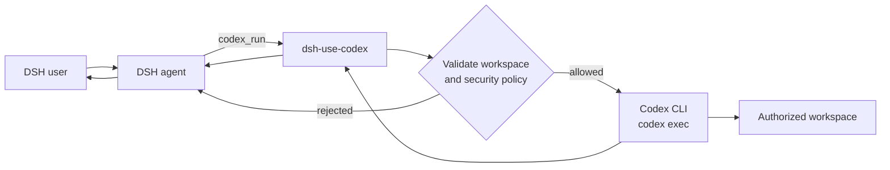

# DSH Use Codex

> Delegate a task from DeepSeek Harness to your local Codex CLI with one natural-language request, then bring the result back to the conversation.

English | [简体中文](README.md)

[](LICENSE)


`dsh-use-codex` adds a small set of tools to [DeepSeek Harness (DSH)](https://github.com/deepseek-ai) for delegating one-shot tasks to the local [OpenAI Codex CLI](https://github.com/openai/codex). It is designed for code changes, debugging, repository analysis, and batch file processing while keeping execution inside explicitly authorized workspaces.

## Contents

- [Features](#features)
- [Requirements](#requirements)
- [Installation](#installation)
- [Configuration](#configuration)
- [Usage](#usage)
- [Tool reference](#tool-reference)
- [How it works](#how-it-works)
- [Security model](#security-model)
- [Development and testing](#development-and-testing)
- [FAQ](#faq)
- [Project status](#project-status)
- [License](#license)

## Features

- **Natural-language delegation**: ask DSH to "let Codex do..." or "hand this to Codex".
- **Three built-in tools**: run a task, inspect status, and toggle the plugin.
- **Workspace allowlist**: Codex can only run in explicitly authorized, real directories.
- **Symlink escape protection**: both the requested directory and configured roots are resolved to real paths.
- **Safe sandbox default**: `workspace-write` is used unless the caller requests otherwise.
- **Two-step dangerous-mode approval**: `danger-full-access` also requires explicit host configuration.
- **No shell interpolation**: the task is passed as a single argv value.
- **Process-group cleanup**: the complete Codex process group is terminated on timeout or cancellation.
- **Bounded output**: stdout and stderr are capped before being returned to the conversation.
- **Minimal state**: only the runtime toggle and update timestamp are persisted.
- **Zero runtime dependencies**: the plugin itself needs no additional npm packages.

## Requirements

| Component | Requirement |
|---|---|
| Node.js | `>= 20` |
| DSH | A version supporting Cordis bundle patches and tool registration |
| Codex CLI | Supports `codex exec`, `-C`, `-s`, and `--ephemeral` |
| Operating system | macOS or Linux; Windows has not been validated |

Validated combination:

- DeepSeek Harness `0.2.1-rc.2`
- Node.js `22.x`
- Codex CLI `0.166.0`

Verify the Codex CLI first:

```bash
codex --version
codex login status
```

> When using a custom OpenAI-compatible provider, a logged-out result from `codex login status` may not indicate a problem. The authoritative check is whether `codex exec` can complete a task.

## Installation

### 1. Get the source

```bash
git clone git@github.com:chaorenzeng/dsh-use-codex.git "$HOME/Projects/dsh-use-codex"
cd "$HOME/Projects/dsh-use-codex"
```

### 2. Register the dependency and bundle in a DSH profile

Edit the target DSH profile's `package.json`, for example `~/.dsh/profiles/web/package.json`:

```json
{
  "dependencies": {
    "dsh-use-codex": "file:/absolute/path/to/dsh-use-codex"
  },
  "dsh": {
    "profile": {
      "bundles": [
        "dsh-use-codex"
      ]
    }
  }
}
```

Keep the existing dependencies and bundles in that file. Then install the profile dependencies:

```bash
cd ~/.dsh/profiles/web
pnpm install
```

If the profile uses another package manager, use the equivalent install command.

### 3. Add local configuration

Override the plugin configuration in the target DSH profile's `cordis.patch.yml`:

```yaml
- id: use-codex
  name: dsh-use-codex
  config:
    enabled: true
    bin: /absolute/path/to/codex
    defaultCwd: /absolute/path/to/workspace
    allowedRoots:
      - /absolute/path/to/workspace
    allowDangerFullAccess: false
    timeoutSec: 900
    maxOutputChars: 20000
```

> Local paths, Codex credentials, and provider settings belong in machine-local configuration and must not be committed to a public repository.

### 4. Restart DSH

Restart the DSH host so the profile loads the plugin for the first time. If it is managed by a macOS LaunchAgent:

```bash
launchctl kickstart -k "gui/$(id -u)/<YOUR_DSH_LAUNCHD_LABEL>"
```

After restarting, **create a new DSH conversation**. Existing conversations do not automatically receive newly registered tools.

### 5. Verify the integration

Send this in a new conversation:

```text
Let Codex do: reply only with USE_CODEX_OK. Do not read or modify any files.
```

A `USE_CODEX_OK` response confirms that the plugin, Codex CLI, and tool-call path are working.

## Configuration

### Plugin options

| Option | Default | Description |
|---|---|---|
| `enabled` | `false` | Register tools when DSH starts; when disabled, no tools are registered |
| `bin` | `codex` | Codex CLI executable path; supports `~` expansion |
| `defaultCwd` | DSH process working directory | Used when `cwd` is omitted; must be an absolute directory inside the allowlist |
| `allowedRoots` | `[defaultCwd]` | Real directories in which Codex may run |
| `allowDangerFullAccess` | `false` | Allow an individual call to request `danger-full-access` |
| `timeoutSec` | `900` | Maximum run timeout, from `1` to `3600` seconds |
| `maxOutputChars` | `20000` | Maximum retained characters for stdout and stderr separately, from `1000` to `200000` |

The public [`cordis.patch.yml`](cordis.patch.yml) uses `/tmp` as a safe placeholder and sets `enabled: false`. Production settings should be kept in the machine-local profile patch.

### Environment variables

| Variable | Description |
|---|---|
| `CODEX_BIN` | Codex CLI path used when `bin` is not configured |
| `USE_CODEX_STATE` | Overrides the runtime toggle state-file path |
| `DSH_HOME` | DSH data directory; state defaults to `use-codex.json` under this directory |

The runtime toggle state file defaults to:

```text
${DSH_HOME:-~/.dsh}/use-codex.json
```

It is created with mode `0600` and contains only:

```json
{
  "enabled": true,
  "updatedAt": "2026-01-01T00:00:00.000Z"
}
```

## Usage

### Natural-language delegation

```text
Let Codex do: inspect why the tests are failing, identify the root cause, and fix it. Do not commit.
```

```text
Hand this to Codex: analyze duplicated code under src and propose a plan before changing anything.
```

DSH decides when to call `codex_run`. Give Codex a clear objective, scope, constraints, and acceptance criteria so it can complete the task independently.

### Specify a workspace and sandbox

```text
Ask Codex to summarize the architecture of /absolute/path/to/repo using the read-only sandbox.
```

### Check status

```text
Check the status of Use Codex.
```

### Disable immediately

```text
Disable Use Codex.
```

New `codex_run` calls are rejected immediately. Re-enabling the plugin does not require a DSH restart.

### Raw tool arguments

```json
{
  "task": "Run the relevant tests and fix the failures. Do not commit.",
  "cwd": "/absolute/path/to/repository",
  "sandbox": "workspace-write",
  "timeoutSec": 600
}
```

## Tool reference

### `codex_run`

Starts one non-interactive `codex exec` task in the requested workspace.

| Argument | Type | Required | Description |
|---|---|---|---|
| `task` | `string` | Yes | Complete task instructions; up to `100000` characters |
| `cwd` | `string` | No | Absolute workspace path that resolves inside `allowedRoots` |
| `sandbox` | `string` | No | `read-only`, `workspace-write`, or `danger-full-access` |
| `timeoutSec` | `number` | No | Per-call timeout, capped by the plugin's configured `timeoutSec` |

The default sandbox is `workspace-write`. `danger-full-access` is rejected unless the host sets `allowDangerFullAccess: true`.

### `codex_status`

Reports:

- current runtime toggle state
- `codex --version`
- `codex login status`
- effective workspace allowlist
- whether dangerous mode is allowed
- timeout and output limits
- a summary of the most recent run in the current DSH process

### `codex_switch`

| Argument | Type | Required | Description |
|---|---|---|---|
| `enabled` | `boolean` | Yes | `true` enables the plugin; `false` disables it |

The runtime toggle is persisted separately and does not affect other DSH plugins.

## How it works



The effective command is equivalent to:

```bash
codex exec \
  -C /absolute/path/to/workspace \
  -s workspace-write \
  --skip-git-repo-check \
  --ephemeral \
  --color never \
  -- "task text"
```

`--ephemeral` disables Codex session reuse; it does not make the run read-only. With `workspace-write`, Codex may modify files inside the authorized workspace.

## Security model

This plugin allows DSH to start the local Codex CLI. Treat any DSH conversation that can access the plugin as having controlled local execution capability.

### Built-in protections

- The workspace must exist, be absolute, and resolve to a real filesystem path.
- The resolved workspace must remain inside `allowedRoots`.
- Symlinks cannot be used to escape an allowed root.
- The task is passed as one argv value without a shell.
- Timeout and cancellation terminate the Codex process group.
- stdout and stderr are bounded.
- Task text, working directories, and outputs are not written to plugin state.
- The public bundle disables dangerous mode by default.

### Deployment guidance

- Install only in a trusted local DSH instance; never expose it to untrusted users.
- Keep `allowedRoots` as narrow as practical.
- Do not enable `allowDangerFullAccess` without additional host-level isolation.
- The Codex child inherits the DSH environment, which may contain credentials.
- `workspace-write` can still modify allowed files; do not allowlist sensitive directories.
- Although task text is not stored in plugin state, it may appear in DSH conversation history, host logs, or Codex logs.
- Keep DSH, Codex CLI, and dependencies up to date.

See [SECURITY.md](SECURITY.md) for the full security policy.

## Development and testing

```bash
git clone <YOUR_REPOSITORY_URL>
cd dsh-use-codex
npm test
```

Tests use temporary directories and a fake Codex executable. They do not call a network service, model, or private workspace. Coverage includes:

- plugin metadata and registration of all three tools
- empty tasks, missing paths, and paths outside the allowlist
- symlink escapes
- dangerous-mode rejection by default
- runtime toggling
- `workspace-write` and `--ephemeral` arguments
- process-group termination on timeout
- minimal state persistence

Inspect the actual npm package contents before publishing:

```bash
npm pack --dry-run
```

Issues and pull requests are welcome. Do not include credentials, private paths, full logs, or other sensitive information in public issues. Report security problems through the private process described in [SECURITY.md](SECURITY.md).

## FAQ

### Why are the tools missing in a new conversation?

Confirm that `dsh.profile.bundles` in `package.json` includes `dsh-use-codex`, `enabled` is `true` in the profile patch, and DSH was restarted. Then create a new conversation.

### Why is the working directory rejected?

`cwd` must be absolute, exist, and resolve inside `allowedRoots`. Invalid allowlist entries are ignored during startup.

### Why does a call fail when `cwd` is omitted?

`defaultCwd` must exist and be inside the allowlist. Set both `defaultCwd` and the corresponding `allowedRoots` entry explicitly.

### Why does `codex_status` report a logged-out state?

With a custom OpenAI-compatible provider, `codex login status` may not reflect actual availability. Verify by running a real `codex exec` task instead.

### Why does a task take so long?

One run may wait up to `900` seconds by default. Set `timeoutSec` within the configured maximum when a shorter or longer limit is required.

### Is a restart required after disabling the plugin?

No. `codex_switch` takes effect immediately. A restart is only required when changing registration-time settings such as `enabled` in the profile configuration.

## Project status

The project is experimental at the `0.x` stage. Tool arguments, configuration fields, and response formats may change as DSH and Codex CLI evolve. Pin validated DSH and Codex CLI versions and rerun the end-to-end check after upgrades.

This is an independent community plugin, not affiliated with or endorsed by DeepSeek or OpenAI. DeepSeek Harness, Codex, and related names and trademarks belong to their respective owners.

## License

[MIT](LICENSE) © 2026 dsh-use-codex contributors
