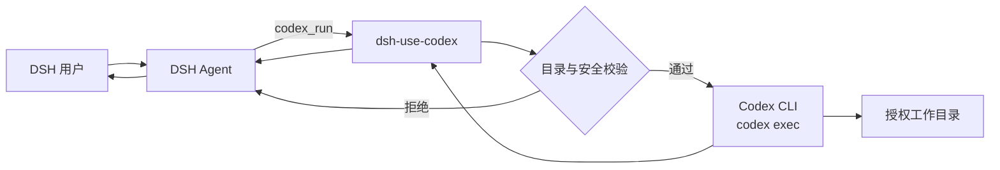

# DSH Use Codex

> 在 DeepSeek Harness 中用一句话把任务交给本机 Codex CLI，安全执行后把结果带回当前会话。

简体中文 | [English](README.en.md)

[](LICENSE)


`dsh-use-codex` 为 [DeepSeek Harness (DSH)](https://github.com/deepseek-ai) 提供一组工具，把独立任务委派给本机 [OpenAI Codex CLI](https://github.com/openai/codex) 执行。它适合代码修改、故障排查、仓库分析和批量文件处理等一次性任务，并将执行结果返回 DSH 当前会话。

## 目录

- [功能特性](#功能特性)
- [运行要求](#运行要求)
- [安装](#安装)
- [配置](#配置)
- [使用方式](#使用方式)
- [工具参考](#工具参考)
- [运行原理](#运行原理)
- [安全模型](#安全模型)
- [开发与测试](#开发与测试)
- [常见问题](#常见问题)
- [项目状态](#项目状态)
- [许可证](#许可证)

## 功能特性

- **自然语言委派**：在 DSH 中说“让 Codex 做……”或“交给 Codex 执行……”。
- **三个内置工具**：任务执行、状态检查、即时开关。
- **工作目录白名单**：只允许 Codex 在显式授权的真实目录中运行。
- **软链逃逸防护**：同时解析工作目录与白名单的真实路径。
- **默认安全沙箱**：默认使用 Codex 的 `workspace-write` 模式。
- **危险模式双重授权**：`danger-full-access` 必须由宿主配置显式允许。
- **无 shell 拼接**：任务正文作为单个 argv 参数传递，避免 shell 注入。
- **进程组清理**：超时或取消时终止完整 Codex 进程组。
- **输出限长**：限制 stdout/stderr，避免单次结果淹没会话。
- **最小状态持久化**：状态文件只记录开关与更新时间，不保存任务、目录或输出。
- **零运行时依赖**：插件本身不需要额外 npm 依赖。

## 运行要求

| 组件 | 要求 |
|---|---|
| Node.js | `>= 20` |
| DSH | 支持 Cordis bundle patch 与工具注册的版本 |
| Codex CLI | 支持 `codex exec`、`-C`、`-s`、`--ephemeral` |
| 操作系统 | macOS 或 Linux；Windows 尚未验证 |

已验证组合：

- DeepSeek Harness `0.2.1-rc.2`
- Node.js `22.x`
- Codex CLI `0.166.0`

先确认 Codex CLI 可用：

```bash
codex --version
codex login status
```

> 如果使用自定义 OpenAI-compatible provider，`codex login status` 显示未登录不一定是错误。请以 Codex CLI 能否实际执行 `codex exec` 为准。

## 安装

### 通过 DSH 插件市场索引安装

在 DSH 的「发现 → 插件市场 → 添加索引源」中添加：

```text
https://raw.githubusercontent.com/chaorenzeng/dsh-use-codex/main/market/index.json
```

然后搜索 **DSH Use Codex** 并安装。市场索引固定到不可变的 Git 提交，实际安装来源仍是本仓库。

### 1. 获取源码

```bash
git clone git@github.com:chaorenzeng/dsh-use-codex.git "$HOME/Projects/dsh-use-codex"
cd "$HOME/Projects/dsh-use-codex"
```

### 2. 在 DSH profile 中登记依赖与 bundle

编辑目标 DSH profile 的 `package.json`，例如 `~/.dsh/profiles/web/package.json`：

```json
{
  "dependencies": {
    "dsh-use-codex": "file:/absolute/path/to/dsh-use-codex"
  },
  "dsh": {
    "profile": {
      "bundles": [
        "dsh-use-codex"
      ]
    }
  }
}
```

保留该文件中已有的依赖和 bundle，不要清空其他配置。然后同步 profile 依赖：

```bash
cd ~/.dsh/profiles/web
pnpm install
```

如果 DSH profile 使用其他包管理器，请使用对应命令安装依赖。

### 3. 添加本机配置

在目标 DSH profile 的 `cordis.patch.yml` 中覆盖插件配置：

```yaml
- id: use-codex
  name: dsh-use-codex
  config:
    enabled: true
    bin: /absolute/path/to/codex
    defaultCwd: /absolute/path/to/workspace
    allowedRoots:
      - /absolute/path/to/workspace
    allowDangerFullAccess: false
    timeoutSec: 900
    maxOutputChars: 20000
```

> 真实路径、Codex 凭据和 provider 设置属于本机配置，不应提交到开源仓库。

### 4. 重启 DSH

重启 DSH 宿主，使 profile 首次加载插件和配置。若由 macOS LaunchAgent 管理，可使用：

```bash
launchctl kickstart -k "gui/$(id -u)/<YOUR_DSH_LAUNCHD_LABEL>"
```

重启后必须**新建一个 DSH 会话**，旧会话不会自动获得新注册的工具。

### 5. 验证

在新建会话中发送：

```text
让 Codex 做：只回复 USE_CODEX_OK，不要读取或修改任何文件。
```

如果返回 `USE_CODEX_OK`，说明插件、Codex CLI 和工具调用链均正常。

## 配置

### 插件配置

| 配置项 | 默认值 | 说明 |
|---|---|---|
| `enabled` | `false` | 是否在 DSH 启动时注册工具；关闭时不注册任何工具 |
| `bin` | `codex` | Codex CLI 可执行文件路径；支持 `~` 展开 |
| `defaultCwd` | DSH 进程工作目录 | 未传 `cwd` 时使用，必须是白名单内的绝对目录 |
| `allowedRoots` | `[defaultCwd]` | 允许 Codex 工作的真实目录列表 |
| `allowDangerFullAccess` | `false` | 是否允许单次调用选择 `danger-full-access` |
| `timeoutSec` | `900` | 单次调用超时上限，范围 `1–3600` 秒 |
| `maxOutputChars` | `20000` | stdout 和 stderr 各自最多保留的字符数，范围 `1000–200000` |

公开仓库中的 [`cordis.patch.yml`](cordis.patch.yml) 使用 `/tmp` 作为安全占位目录，并默认设置 `enabled: false`。部署时应只在个人 profile patch 中覆盖为真实配置。

### 环境变量

| 环境变量 | 说明 |
|---|---|
| `CODEX_BIN` | 未配置 `bin` 时使用的 Codex CLI 路径 |
| `USE_CODEX_STATE` | 覆盖即时开关状态文件路径 |
| `DSH_HOME` | DSH 数据目录；状态默认写入其下的 `use-codex.json` |

即时开关状态文件默认位于：

```text
${DSH_HOME:-~/.dsh}/use-codex.json
```

文件权限为 `0600`，内容仅包含：

```json
{
  "enabled": true,
  "updatedAt": "2026-01-01T00:00:00.000Z"
}
```

## 使用方式

### 自然语言调用

```text
让 Codex 做：检查当前仓库为什么测试失败，定位原因并修复；不要提交 commit。
```

```text
交给 Codex 执行：分析 src 目录中的重复代码，先给出方案，不要直接修改。
```

DSH 的模型会按需调用 `codex_run`。任务应写清目标、范围、约束和验收标准，以便 Codex 独立完成。

### 指定工作目录和沙箱

```text
让 Codex 做：只读取这个仓库并总结架构。工作目录使用 /absolute/path/to/repo，使用 read-only 沙箱。
```

### 查看状态

```text
检查 Codex 委派的状态。
```

### 即时关闭

```text
关闭 Codex 委派。
```

关闭后 `codex_run` 会立即拒绝新任务；重新打开不需要重启 DSH。

### 直接调用工具参数

```json
{
  "task": "运行相关测试并修复失败原因，不要提交 commit。",
  "cwd": "/absolute/path/to/repository",
  "sandbox": "workspace-write",
  "timeoutSec": 600
}
```

## 工具参考

### `codex_run`

在指定工作目录中启动一次非交互式 `codex exec` 任务。

| 参数 | 类型 | 必填 | 说明 |
|---|---|---|---|
| `task` | `string` | 是 | 完整任务说明；最大 `100000` 字符 |
| `cwd` | `string` | 否 | 绝对工作目录，必须位于 `allowedRoots` 内 |
| `sandbox` | `string` | 否 | `read-only`、`workspace-write` 或 `danger-full-access` |
| `timeoutSec` | `number` | 否 | 本次超时，不能超过插件配置的 `timeoutSec` |

默认沙箱为 `workspace-write`。`danger-full-access` 默认拒绝，只有在宿主配置中设置 `allowDangerFullAccess: true` 后才可选择。

### `codex_status`

只读检查以下信息：

- 即时开关状态
- `codex --version`
- `codex login status`
- 有效目录白名单
- 危险模式是否允许
- 超时与输出限制
- 当前 DSH 进程内最近一次调用的结果摘要

### `codex_switch`

| 参数 | 类型 | 必填 | 说明 |
|---|---|---|---|
| `enabled` | `boolean` | 是 | `true` 打开，`false` 关闭 |

即时开关持久化到状态文件，不影响 DSH 宿主中的其他插件。

## 运行原理



插件最终执行的核心命令等价于：

```bash
codex exec \
  -C /absolute/path/to/workspace \
  -s workspace-write \
  --skip-git-repo-check \
  --ephemeral \
  --color never \
  -- "任务正文"
```

`--ephemeral` 表示不复用 Codex 会话，不表示只读。若 Codex 获得 `workspace-write`，它仍可能修改允许目录中的文件。

## 安全模型

本插件允许 DSH 启动本机 Codex，因此应把 DSH 会话视为具备受控本机执行能力。

### 已有防护

- 工作目录必须存在、为绝对路径，并通过真实路径解析。
- 工作目录必须位于 `allowedRoots` 内。
- 解析软链后仍须位于白名单内，阻止软链逃逸。
- 任务作为单个 argv 参数传入，不经过 shell。
- 超时或取消时终止 Codex 进程组。
- stdout/stderr 有长度上限。
- 插件状态不保存任务正文、工作目录或执行输出。
- 公共 bundle 默认关闭危险模式。

### 部署建议

- 只安装在可信的本机 DSH 中，不要把 DSH 暴露给不可信用户。
- 将 `allowedRoots` 收窄到实际需要的仓库或目录。
- 除非宿主机已做额外隔离，否则不要开启 `allowDangerFullAccess`。
- Codex 子进程会继承 DSH 环境变量，其中可能包含凭据；请检查 DSH 运行环境。
- `workspace-write` 仍允许修改工作区，不应把敏感目录加入白名单。
- 任务正文虽不写入插件状态，但仍可能出现在 DSH 对话记录、宿主日志或 Codex 自身日志中。
- 保持 DSH、Codex CLI 和依赖项更新。

完整安全说明见 [SECURITY.md](SECURITY.md)。

## 开发与测试

```bash
git clone https://github.com/chaorenzeng/dsh-use-codex.git
cd dsh-use-codex
npm test
```

测试使用临时目录和假 Codex 可执行文件，不访问网络、真实模型或私有工作区。当前覆盖：

- 插件元数据与三个工具注册
- 空任务、无效目录和白名单外目录
- 软链逃逸
- 危险模式默认拒绝
- 即时开关
- `workspace-write` 与 `--ephemeral` 参数
- 超时进程组终止
- 状态文件最小化持久化

提交前可检查 npm 实际打包内容：

```bash
npm pack --dry-run
```

欢迎提交 Issue 和 Pull Request。请勿在公开 Issue 中提交凭据、私有路径、完整日志或其他敏感信息；安全问题请参考 [SECURITY.md](SECURITY.md) 的私密报告流程。

## 常见问题

### 为什么新建会话后看不到工具？

先确认 `package.json` 的 `dsh.profile.bundles` 包含 `dsh-use-codex`，profile patch 中 `enabled` 为 `true`，然后重启 DSH 并新建会话。

### 为什么提示工作目录不在白名单内？

`cwd` 必须是绝对路径、真实存在，并在解析软链后位于 `allowedRoots` 内。白名单中的无效目录也会被忽略。

### 为什么不传 `cwd` 会失败？

`defaultCwd` 必须存在且位于白名单内。推荐在 profile 配置中同时显式设置 `defaultCwd` 和对应的 `allowedRoots`。

### 为什么 `codex_status` 显示未登录？

使用自定义 OpenAI-compatible provider 时，`codex login status` 可能不反映实际可用性。请直接验证 `codex exec` 是否能完成任务。

### 为什么任务执行很久？

单次执行默认最多等待 `900` 秒。可以在配置范围内通过 `timeoutSec` 调整，超出上限的值会被限制到插件配置的最大值。

### 关闭插件后是否还需要重启？

不需要。`codex_switch` 的关闭状态立即生效。若要在启动时不注册工具，则需在 profile 配置中设置 `enabled: false` 并重启 DSH。

## 项目状态

项目处于 `0.x` 实验阶段，工具参数、配置字段和返回格式可能随 DSH 与 Codex CLI 的演进调整。发布前建议固定已验证的 DSH 和 Codex CLI 版本，并在更新后进行端到端验证。

本项目是独立的社区插件，与 DeepSeek 或 OpenAI 无隶属或官方背书关系。DeepSeek Harness、Codex 及相关名称和商标归各自权利人所有。

## License

[MIT](LICENSE) © 2026 dsh-use-codex contributors
